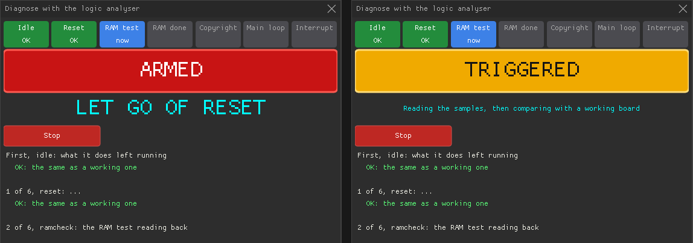
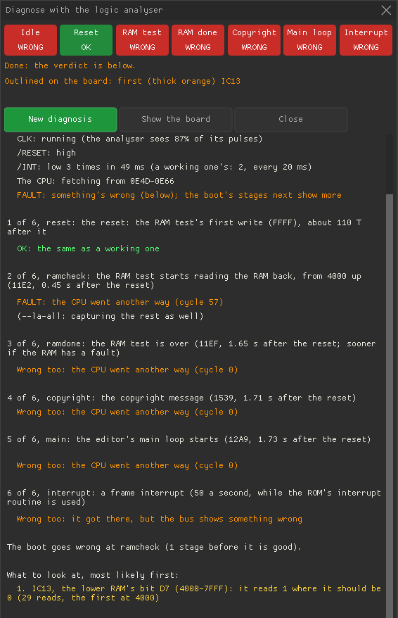
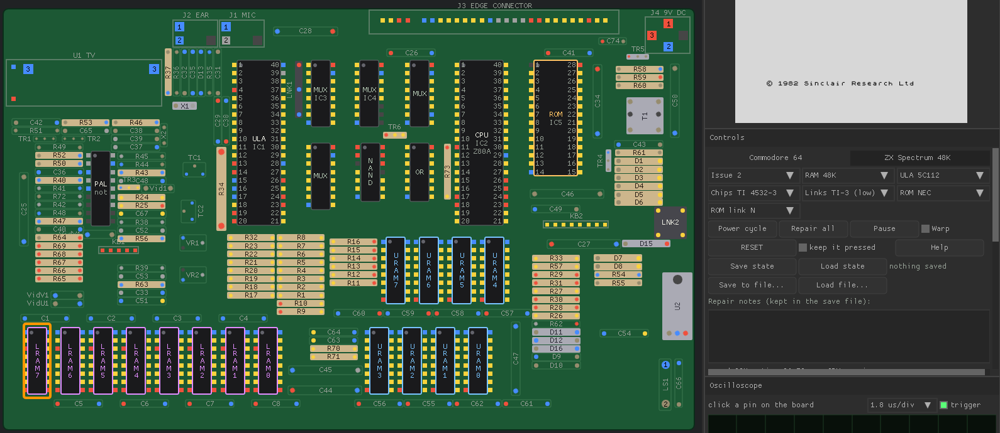

# Diagnosing with a logic analyser

[ZX Spectrum 48K](zx-spectrum-48k.md) · [Diagnostics and repair records](../diagnostics.md)

The analyser is HappyLittleDiodes' (Jim's) ZX Spectrum interface on the
edge connector, with two of Agustin Gimenez Bernad's LogicAnalyzer boards
(github.com/gusmanb/logicanalyzer, Pico 2) chained as one 48 channel
device, each on its own USB lead. The simulator talks to the boards itself
(no LogicAnalyzer program needed) and compares what the real Spectrum does
with the simulated board, stage by stage:

1. Idle: the Spectrum left running, no reset: the clock, /RESET (low,
   pulsing), /WAIT and /BUSRQ held, the frame interrupt (49 ms at 2 MHz),
   where the CPU is. It needs no reset, so it works when /RESET is broken;
   when the CPU isn't running at all the stages below are skipped.
2. Six stages of the boot, each after a press of the reset button: the
   reset, the RAM test reading back, the RAM test's end, the copyright
   message, the editor's main loop, a frame interrupt.

Then what to look at, most likely first, with the chips named from the
board's netlist: a stuck line and every chip on it, a data line, the ROM,
which RAM chip (by the bit and the bank) or a chip that answers late, a
RAM bank's address line and its multiplexer, an address line the ROM sees
otherwise than the connector (a weak CPU output), the ULA's clock, its
contention timing and its keyboard lines, a dead CPU. /M1 and /RFSH, which
nothing on a 48K uses, are only a note. Checked on real faulty boards:
ULAs, Z80s, 74LS157 multiplexers and 4116 RAM chips.

In the window: **Diagnose** > **Diagnose with the logic analyser...** (with
a Spectrum on the bench). Press **Find boards**: it shows which board it
takes as the master (the one nearest the Spectrum, channels 1-24) and the
slave. The first time it's a guess, Windows' order: if it's the wrong way
round press **Swap** (not sure which is which? unplug the slave's USB lead
and press Find boards). It's remembered by the boards' serial numbers in
`la-boards.txt` beside the program, on any PC. Then the green **Start**, and answer its
questions with the buttons (green **Continue**, red **Stop**). A row of
boxes shows the stages (blue: now, green: OK, red: wrong; click one for
its text). When it's waiting for the Spectrum it shows a big red
**ARMED** and what to do (LET GO OF RESET), then **TRIGGERED** once it
has captured. At the end the chips to look at are outlined on the board,
the first ones thick; **New diagnosis** clears it all for the next board. Every run captures afresh
into `last-diagnosis`; to keep one, type the board's name after
`diagnosis-` under **Save as** and press **Save**. The same window
diagnoses a saved folder of captures again, or the simulated board with a
fault as the one under test.

Above: the RAM test stage, waiting for the Spectrum's reset to be let go,
then captured. Below: the end of a run on a real Issue 2 with a faulty
4116 (IC13, which was the bad chip), and the chip outlined on the board.

## The screen as well

The analyser sees the CPU's bus, not the picture; a screenshot of the
monitor covers what it can't (the ULA's video side, the lower RAM as the
ULA reads it). The **Screen** row, before Start or after a run, takes one:
**Choose...**, **Paste** (or Ctrl+V, or drop it on the window), or, with
no capture card, **Pick a type...**: the kinds of screen (no picture, one
colour, a blank screen in a border, wide bars, thin stripes, a repeating
pattern, coloured blocks, garbled text, the copyright message), each with
the simulated faults' pictures to pick the nearest from. It's matched
against the fault atlas (as "Diagnose screenshot" does), with what the bus
showed:

- the bus named a part: whether the screen agrees (a fault on that part
  gives that picture too), or what the screen points at instead;
- the bus found nothing wrong: the screen's own suspects, those the bus
  would most likely have shown (the CPU, the ROM, the RAM chips) left to
  a note. A bad ULA's video side shows up here.

Given after a run, it's matched at once, without capturing again. The
picture is kept with the captures (`screen.png`), and a replay of the
folder uses it by itself.

**Check the screen's faults against the captures** then puts each of the
screen's faults (24 at most, plus a working board to measure them
against) on the simulated board and compares every stage with what the
analyser took: the fault that does what the real board did, stage by
stage, is the one. It takes a minute or two on half the processors
(`LA_JOBS=N` for another number). On a real Issue 2 with a faulty IC13,
IC13's faults came first, 5 of the 6 stages the same, a working board 2.

From the command line:

- `--la-diagnose DIR --board issue2 [--la-ports MASTER,OTHER] [--la-all]`
  as the window does (`--la-replay`: from DIR's captures again;
  `--la-simulate --fault SPEC`: the simulated board). The captures and
  `diagnosis.txt` (every comparison) go in DIR, replacing the ones from an
  earlier run there. `--la-screen PICTURE` adds the screen;
  `--la-check [N]` then checks its faults (N, 24 unless given) against
  the captures; with no screen, after a fault, it checks the faults of
  the parts the verdict names (each removed, its data bits, then the
  rest). `--option ram=16k` for a 16K board (the window takes the
  board's options from the Controls): it is compared with a working 16K.
- `--la-devices` lists the boards; `--la-capture FILE --la-trigger STAGE`
  takes one capture; `--la-info`, `--la-cycles`, `--la-compare FILE`
  read and compare captures (`.lac` or CSV, as the LogicAnalyzer program
  saves them); `--la-record FILE` records the simulated board as the
  analyser would.
- `tests/la-diagnose.sh [CAPTURES]` replays every diagnosis folder taken so
  far and a set of simulated faults, and shows what changed against
  `tests/la-diagnose-expected.txt`.

Captures are taken at 14.285714 MHz (100 MHz / 7), 98,000 samples: 6.9 ms.
The boards need the zx firmware (`la-firmware/`; `--la-bootsel` restarts a
board into its USB drive mode to copy it on) for triggers that ignore
glitches on the address lines.
